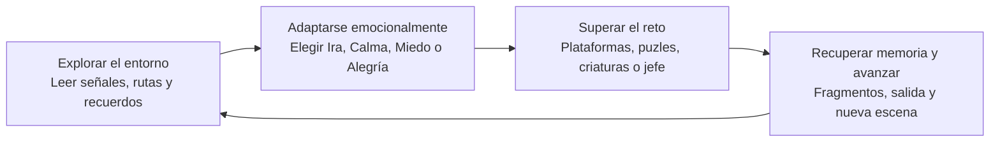

# EMO-SHIFT TRAVEL — Core loop

**Material de reunión · v13.3**  
**Copia integrada de trabajo:** v13.3 · **Juego:** plataformas 2D narrativo de emociones

> **En una frase:** explora una estación hecha de recuerdos, cambia de emoción para transformar el camino, supera sus retos y recupera piezas que ayudan a Nara a comprender su historia y acercarse a Tomás, que está recibiendo atención en el hospital.

## Diagrama principal

El ciclo va de **leer** a **actuar**, y de la acción a una nueva lectura: la estación cambia, aparecen piezas del pasado y el siguiente obstáculo invita a probar otra emoción. La salida avanza la campaña; los fragmentos son coleccionables y, al reunirlos todos en un nivel, desbloquean su recuerdo completo.

## El ciclo, en cinco verbos

1. **Explorar.** Recorre el tramo, identifica apoyos, peligros, personajes, señales y pistas de la historia.
2. **Interpretar.** Reconoce qué regla está bloqueando el avance y qué emoción puede cambiarla.
3. **Adaptarse.** Alterna entre Ira, Calma, Miedo y Alegría para habilitar una posibilidad: romper, flotar, revelar o elevarse.
4. **Superar y recordar.** Resuelve el reto de plataformas, puzle, criatura o jefe; recoge fragmentos opcionales y descubre qué añade el lugar a la historia familiar.
5. **Avanzar.** Activa la salida y llega a un nuevo espacio con otra combinación de señales, retos y recuerdos. **El paso 5 reinicia el ciclo en Explorar.**

## Tres preguntas de diseño

| Pregunta | Respuesta en EMO-SHIFT TRAVEL |
|---|---|
| **¿Qué hace el jugador?** | Explora y reinterpreta el entorno al cambiar de emoción; supera retos y avanza por una estación hecha de recuerdos. |
| **¿Qué se lo impide?** | Terreno y rutas interrumpidas, peligros, enemigos y jefes, puzles que piden la emoción o el orden adecuados, y la incertidumbre de los recuerdos incompletos. |
| **¿Por qué sigue?** | Quiere comprender cómo vivieron de forma distinta la enfermedad y el cuidado de su madre, y decidir cómo acercarse a su hermano sin suponer que una llamada lo resolverá todo. |

## Emociones: la decisión que mueve el ciclo

| Estado | Oportunidad de juego |
|---|---|
| **Ira** | Dash ofensivo; rompe barreras y calienta válvulas. |
| **Calma** | Permite caminar sobre el agua y subir por vapor. |
| **Miedo** | Revela plataformas que estaban ocultas. |
| **Alegría** | Da doble salto y aprovecha corrientes ascendentes. |

El jugador cambia de emoción cuando el espacio lo invita a reconsiderar su estrategia. La emoción activa también da al escenario y al cabello de Nara una señal visual mate, sin neón.

## Bucles que apoyan al principal

- **Progreso narrativo:** completar un nivel abre su escena de cierre y el siguiente tramo; el grafo de campaña incluye bifurcaciones y reencuentros.
- **Colección y personalización:** recoger fragmentos suma puntos de memoria; se gastan en mejoras y cosméticos. Completar la colección de un mapa habilita su escena de recuerdo completa.
- **Aprendizaje:** carteles y consejos introducen el resorte y el vapor cerca de donde se usan; checkpoints permiten volver al reto sin reiniciar el viaje.
- **Jefes:** observar un aviso, evitar el patrón y entrar durante la recuperación hace que el cambio de emoción/dash tenga un propósito legible.

Estos son bucles de apoyo y metas de mayor escala; no sustituyen el ciclo principal de explorar, adaptarse y superar retos.

## Alcance de esta propuesta

Este diagrama resume los sistemas de la copia de trabajo v13.3. La integración no modifica el personaje principal ni sus reglas. Los fragmentos no son un requisito general para abrir la salida, y el co-op remoto sigue siendo experimental: no forma parte del core loop de campaña individual.

## Referencia de diseño

La estructura sigue la guía [Core Loop — Deliberate Game Design](https://deliberategamedesign.com/core-loop/): representar pocas acciones amplias, explicar cómo una conduce a la siguiente y responder qué hace el jugador, qué lo detiene y por qué continúa. El artículo recomienda mantener el ciclo compacto (entre dos y cinco elementos como referencia del autor); por eso el diagrama usa cuatro verbos agrupados y el paso de avance como retorno al inicio. Aplicación propia al juego; no se reutiliza su arte ni su ejemplo.

© 2026 Grillo Studio · Preparado para presentación interna
